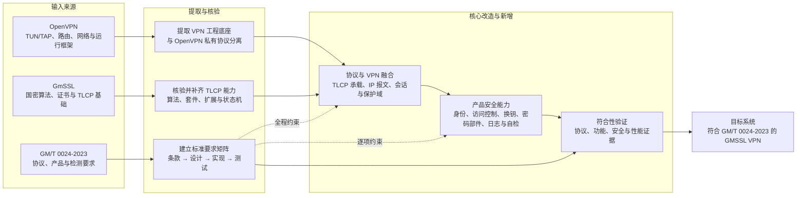

# 第 1 章：技术地图

> 本章回答：OpenVPN、GmSSL 和 GM/T 0024-2023 是什么关系？

## 本章目标

在开始设计和开发之前，先看清整个技术版图。

本章不讲具体 API，也不分析源码调用链，只解决三个基础问题：

1. 最终要开发的 GMSSL VPN 是什么；
2. OpenVPN 和 GmSSL 分别能提供什么；
3. 距离符合 GM/T 0024-2023 技术要求还缺什么。

先给出结论：

```text
OpenVPN 的 VPN 工程能力
        +
GmSSL 的国密算法与 TLCP 能力
        +
按照 GM/T 0024-2023 新设计的协议衔接、会话、策略和产品能力
        ↓
GMSSL VPN
```

这里所说的 **GMSSL VPN**，是按照 GM/T 0024-2023 设计并实现的完整 SSL VPN 目标系统，不是 GmSSL 上游提供的某个现成 VPN 产品。

## 1.1 先看最终系统

SSL VPN 的基本作用，是在不可信网络上建立一条经过身份认证和密码保护的通道，使远程终端或远端网络能够安全访问受保护网络。

客户端—服务端模式下，最终系统大致如下：


一条 IP 报文经历的主路径是：

```text
客户端应用
→ 操作系统路由
→ TUN
→ VPN 客户端
→ TLCP 加密传输
→ VPN 服务端
→ 访问控制
→ 受保护网络
```

返回报文沿相反方向传输。

GM/T 0024-2023 涉及两种系统形态：

- **客户端—服务端模式**：远程终端通过 SSL VPN 服务端访问受保护资源，是标准要求的基本模式，也是首先需要完成的主线；
- **网关—网关模式**：两个网络安全网关之间建立受保护通道，使两侧保护域互联，属于可选模式。

标准中的网关—网关模式不是对普通“站点互联”的泛称。它使用类型值为 80 的 `site2site` 记录承载控制报文和数据报文：控制报文交换 IPv4/IPv6、协议和端口等保护域，数据报文承载完整 IP 包，连接还要与两端保护域绑定。

无论采用哪种模式，完整系统都不只是一条加密连接。它还需要处理虚拟网络、路由、身份、会话、访问策略、证书、密钥更新、日志和运行管理。

## 1.2 先理解 TLCP

TLCP（Transport Layer Cryptography Protocol，传输层密码协议）负责在通信双方之间建立经过身份认证和密码保护的安全通道。十年前开发中常见的“国密 SSL”或“GMSSL 协议”，在当前标准体系中应从 TLCP 的概念来理解。

TLCP、TCP 和 VPN 分别解决不同问题：

| 层次 | 负责什么 |
|---|---|
| TCP | 建立可靠网络连接并传输字节流 |
| TLCP | 完成身份认证、密码套件协商、密钥建立和记录保护 |
| VPN | 建立虚拟网络，并管理地址、路由、用户会话和访问策略 |

它们在系统中的关系是：

```text
VPN：虚拟地址、路由、会话和访问控制
                    ↓
TLCP：认证、密钥协商和安全报文传输
                    ↓
TCP：可靠网络传输
```

一次 TLCP 安全连接经过以下主过程：

```text
建立 TCP 连接
→ 协商 TLCP 版本和密码套件
→ 交换并验证证书或身份参数
→ 完成身份认证和密钥计算
→ 使用工作密钥保护应用数据
→ 更新密钥或安全关闭连接
```

本规范采用 TLCP 1.1，线上版本值为 `0x0101`。TLCP 与普通 TLS 解决相同类型的安全传输问题，但具有自己的版本、密码套件、证书使用方式、握手过程和密钥计算规则。因此，“在 TLS 中启用 SM2、SM3、SM4”不能直接等同于实现 TLCP。

TLCP 只建立安全通道，并不负责 TUN、路由、虚拟地址和访问控制。只有在 TLCP 之上补齐这些 VPN 能力，才能形成完整的 SSL VPN。

## 1.3 OpenVPN 提供什么

OpenVPN 是一个成熟的 VPN 系统。它已经解决了大量与密码算法无关、但实现 VPN 必不可少的工程问题。

OpenVPN 的基本数据路径可以简化为：

```text
TUN/TAP
↕
报文读取与转发
↕
OpenVPN 控制通道和数据通道
↕
TCP/UDP 网络连接
```

对 GMSSL VPN 最有价值的，是下面这些能力：

| OpenVPN 能力 | 作用 | 在目标系统中的定位 |
|---|---|---|
| TUN/TAP | 在操作系统与 VPN 程序之间交换 IP 报文或以太网帧 | 保留并重新封装接口 |
| 路由与地址 | 配置虚拟地址、路由和网络参数 | 保留通用能力 |
| Socket 与事件循环 | 管理非阻塞网络读写和定时任务 | 保留并接入 TLCP 状态 |
| 客户端生命周期 | 连接、重连、关闭和资源清理 | 借鉴并改造 |
| 多客户端管理 | 管理连接实例、虚拟地址和转发关系 | 借鉴结构，重做安全会话 |
| 配置与运行管理 | 启动参数、状态、日志和守护进程 | 提取与协议无关的部分 |

但是，OpenVPN 不只是一个 TUN 工具。它还定义了自己的线上协议，包括控制报文、可靠传输、密钥协商方式和数据通道报文。

这些 OpenVPN 私有协议不能直接当作 GM/T 0024-2023 的协议实现：

| OpenVPN 能力 | 原因 | 处理方式 |
|---|---|---|
| TLS 控制通道 | 服务于 OpenVPN 自己的会话和密钥协商 | 由标准 TLCP 路径替代 |
| 控制包与 ACK | 属于 OpenVPN 私有线上报文 | 不进入标准通信路径 |
| 数据通道格式 | 不是 TLCP 记录层 | 由 TLCP 保护的数据承载替代 |
| OpenVPN PRF 与数据密钥 | 不等同于标准规定的密钥计算 | 按 TLCP 和标准重新实现 |
| OpenVPN 密码协商 | 使用 OpenVPN 自身配置和协商语义 | 改为标准密码套件语义 |

因此，OpenVPN 在这里更接近一个成熟的 **VPN 工程底座**，而不是可以原样保留的标准协议栈。

## 1.4 GmSSL 提供什么

GmSSL 是面向国密算法、密码协议和密码设备的开源密码库。它为 GMSSL VPN 提供密码学和 TLCP 基础。

### 国密算法

| 能力 | 在 GMSSL VPN 中的主要用途 |
|---|---|
| SM2 | 数字签名、身份认证以及标准规定的密钥交换或加密操作 |
| SM3 | 摘要、消息认证和密钥计算 |
| SM4-CBC | TLCP 记录层的分组加密保护 |
| SM4-GCM | TLCP 记录层的认证加密保护 |

这些算法并不是彼此独立地“加到 VPN 里”。它们通过密码套件被 TLCP 组合起来，共同完成身份认证、密钥建立和记录保护。

上表是首先贯通的国密主路径，不是标准规定的全部算法范围。GM/T 0024-2023 表 2 共列出 12 个密码套件，还涉及基于 SM9 的 IBC/IBSDH、RSA 和 SHA-256，并覆盖 CBC 与 GCM 两类记录保护方式。因此，不能把“完成 SM2 + SM3 + SM4”直接等同于“完成标准密码套件覆盖”。开发时必须按表 2 建立逐套件的[实现、互操作和测试矩阵](appendix/cipher-suite-matrix.md)。

### TLCP 协议能力

GmSSL 为 TLCP 的握手、证书处理、密钥计算和记录读写提供基础实现。按照 GM/T 0024-2023 形成完整协议能力时，需要以标准规定的版本、密码套件、状态机和异常处理为准，并完成相应的实现与验证。

TLCP 记录层承载握手、报警、密码规格变更、应用数据以及网关—网关数据；记录保护既包括 CBC 下的加密与消息认证，也包括 GCM 认证加密。

密钥也不是一个单独的“会话密钥”，而是按层次形成：

```text
预主密钥
→ 主密钥
→ 客户端/服务端分别使用的发送、接收工作密钥
→ 数据加密密钥和消息认证密钥
```

GmSSL 提供 TLCP 客户端、服务端、证书处理和记录读写等基础能力。它还支持签名证书和加密证书分离的双证书使用方式。

### GmSSL 的能力边界

GmSSL 解决的是“怎样建立国密安全通道”，但它不负责：

- 创建 TUN/TAP；
- 配置虚拟地址和系统路由；
- 管理 VPN 用户和虚拟地址池；
- 判断某个用户能否访问某个网络或端口；
- 把多个客户端映射到受保护网络；
- 实现完整的 VPN 管理、审计和产品功能。

因此，能够用 GmSSL 建立 TLCP 连接，只表示安全通道已经具备基础，并不等于 SSL VPN 已经完成。

## 1.5 GM/T 0024-2023 要求什么

GM/T 0024-2023《SSL VPN 技术规范》是这套实现的目标基线。它关注的不只是密码算法，还包括协议行为和 SSL VPN 产品能力。

从开发角度，可以先把标准要求看成六个部分：

| 范围 | 开发者需要关注的内容 |
|---|---|
| 密码与密钥 | 算法、密码套件、随机数、双证书和密钥层次 |
| TLCP 协议 | 记录、握手、报警、密码规格变更和密钥计算 |
| VPN 功能 | 客户端—服务端、网关—网关和安全数据传输 |
| 策略与换钥 | 用户/组访问控制、时间策略以及时间和流量双条件换钥 |
| 产品安全 | 密码部件、私钥保护、管理、日志、初始化、加固和自检 |
| 性能与测试 | 连接、用户、吞吐指标以及可复核的测试证据 |

其中有几项容易被“协议已经跑通”掩盖，却是严格实现不能绕过的硬要求：

| 硬要求 | 对实现的直接含义 |
|---|---|
| 随机数 | 随机数应由多个硬件噪声源产生，软件伪随机方案不能直接作为产品符合性结论 |
| 密码运算 | 密码运算应在独立密码部件中完成，软件密码库还需要明确密码部件集成边界 |
| 访问控制 | 应能按用户或用户组控制 IP 地址、端口、Web URL 和访问时间 |
| 工作密钥更新 | 时间周期和报文流量两种触发方式都是必需项；客户端—服务端最长 8 小时，网关—网关最长 1 小时 |
| 工作密钥销毁 | 工作密钥只应在易失性存储中存在，并在断连、断电和实例释放时销毁 |
| 产品验证 | 除协议互通外，还要验证最大并发连接数、每秒新建连接数、最大并发用户数、加解密吞吐率、安全管理和自检 |
| 软件安全 | 安全协议及管理软件应形成自主实现和维护能力，操作系统完成安全加固，产品定型后封闭调试与检测接口 |

这意味着下面三种情况都不能单独代表完整实现：

```text
只支持 SM2、SM3、SM4                  不够
只完成 TLCP 客户端和服务端握手          不够
只让两端通过 TUN 互相 ping 通            不够
```

完整目标应当同时形成：

```text
正确的密码与 TLCP 协议
+ 可用的 VPN 数据通道
+ 身份、会话与访问控制
+ 密钥、管理、审计和自检
+ 与标准要求对应的验证证据
```

因此，本指南需要始终区分三个层次：

| 层次 | 完成标志 |
|---|---|
| 协议实现 | 标准报文、状态机、算法和密钥处理正确 |
| SSL VPN 产品实现 | 网络、身份、策略、密码部件和安全管理形成完整系统 |
| 符合性结论 | 第 7 章的每项要求均有第 8 章对应测试和可复核证据 |

前一层完成并不会自动证明后一层完成。尤其是“GmSSL 能建立 TLCP 连接”，不能直接推出整个 SSL VPN 产品符合 GM/T 0024-2023。

本章只展示标准的整体轮廓。具体要求将在后续总体设计、开发路线和符合性验证中逐步落到系统能力上。

## 1.6 三者怎样组合

现在可以把三个来源、核心改造和最终目标放到同一张图中：



这张图需要从左向右理解：

1. **OpenVPN 是工程来源**：保留通用 VPN 能力，排除其私有线上协议；
2. **GmSSL 是密码与协议来源**：复用已有能力，同时逐项核验与标准之间的差距；
3. **GM/T 0024-2023 是约束来源**：它不是一个软件组件，而是贯穿设计、实现和测试的要求基线；
4. **核心开发不是简单“连接两个项目”**：而是完成协议承载、VPN 接入会话、产品安全和符合性证据四个层面的融合；
5. **最终输出以验证闭环为准**：只有要求、实现和测试证据能够逐项对应，才能形成符合标准的目标系统。

对应关系如下：

| 来源 | 主要贡献 |
|---|---|
| OpenVPN | TUN/TAP、路由、Socket、事件循环、多客户端和跨平台经验 |
| GmSSL | SM2、SM3、SM4、TLCP、X.509、双证书和密码设备接口 |
| GM/T 0024-2023 | 协议、密码、功能、安全管理和验证目标 |
| 新开发部分 | 把安全通道变成完整 VPN 所需的衔接和产品能力 |

真正的核心开发工作主要集中在以下几个缺口：

1. 用 TLCP 替换 OpenVPN 私有协议在标准路径中的作用；
2. 在 TLCP 应用数据或 `site2site` 记录中，按相应模式正确承载 VPN 控制信息和 IP 报文；
3. 把证书身份、连接、虚拟地址和访问策略绑定成安全会话；
4. 逐项核验并补齐 GmSSL 对标准算法、密码套件、扩展、状态机和异常处理的覆盖；
5. 完成双条件换钥、独立密码部件、硬件随机源、日志、管理和自检等产品能力；
6. 对安全协议及管理软件建立可审查、可维护、可复现的自主实现边界；
7. 建立标准要求、设计、实现、测试和证据之间的对应关系。

这些缺口决定了后续的总体架构和开发路线。

## 1.7 本章小结

读完本章，应当记住五句话：

1. **TLCP 负责安全通道，VPN 负责虚拟网络、会话和访问控制。**
2. **OpenVPN 提供 VPN 工程能力，但它的私有线上协议不是 GM/T 0024-2023。**
3. **GmSSL 提供国密算法和 TLCP 基础，但它本身不是一个完整 VPN。**
4. **GM/T 0024-2023 同时约束协议、VPN 功能、产品安全、性能和测试。**
5. **GMSSL VPN 的核心工作，是在标准要求下组合、补齐并逐项验证这些能力。**

下一章将在这张技术地图之上，给出客户端、服务端、核心组成和关键数据流的总体设计。

## 参考资料

- GM/T 0024-2023《SSL VPN 技术规范》
  - 第 5 章：密码算法与密钥
  - 第 6 章：协议
  - 第 7 章：产品要求
  - 第 8 章：检测要求
  - 第 9 章：判定规则
- [OpenVPN Community](https://github.com/OpenVPN/openvpn)
- [GmSSL](https://github.com/guanzhi/GmSSL)
