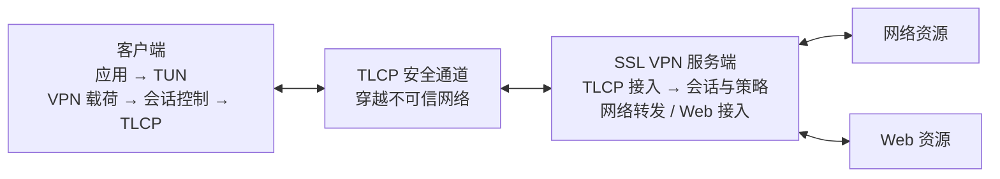
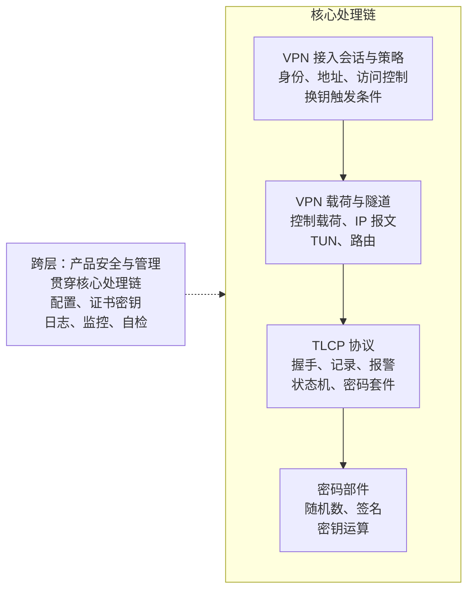
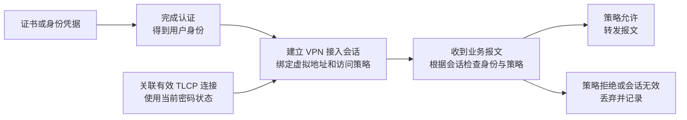
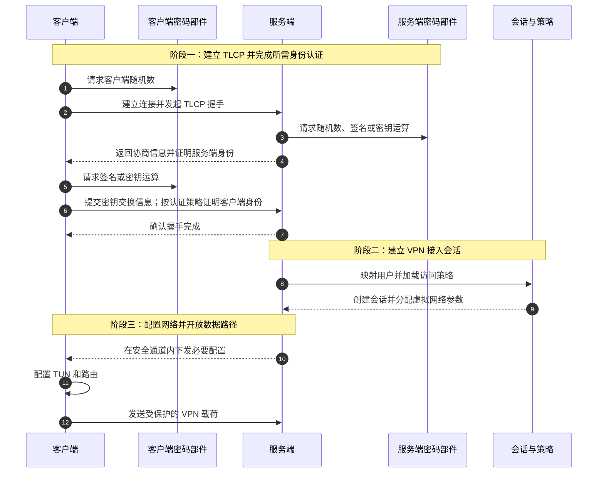

# 第 2 章：总体设计

> 本章回答：OpenVPN 与 GmSSL 应该怎样组成一个符合 GM/T 0024-2023 目标要求的 SSL VPN？

## 本章目标

第一章说明了技术来源和标准边界，本章把它们落实为一套系统蓝图。

读完本章，读者应当能够回答四个问题：

1. 客户端、服务端和密码部件怎样协作；
2. TLCP 安全通道怎样承载 VPN 流量；
3. VPN 接入会话、TLCP 连接和密码状态怎样保持安全绑定；
4. OpenVPN、GmSSL 和新增代码的边界在哪里。

本章只讨论总体结构和关键流程。API、报文字段、源码调用链和测试用例留到后续开发与验证阶段。

## 2.1 设计目标与边界

GMSSL VPN 不是“更换密码套件后的 OpenVPN”，而是以 GM/T 0024-2023 为线上协议和产品能力基线，重新组合三类能力：

```text
OpenVPN 的网络与运行底座
+ GmSSL 的密码与 TLCP 基础
+ 新设计的载荷、会话、策略和产品安全能力
= GMSSL VPN
```

系统需要容纳两种标准形态：

| 形态 | 定位 | 总体设计决策 |
|---|---|---|
| 客户端—服务端 | 基本模式 | 作为第一条完整实现主线 |
| 网关—网关 | 可选模式 | 共用密码与运行底座，独立实现 `site2site` 协议路径 |

第一条主线必须形成下面这条完整关系：

```text
客户端身份
→ TLCP 连接
→ VPN 接入会话
→ 虚拟地址
→ 访问策略
→ 受保护资源
```

只建立加密连接而没有后面的会话与授权关系，不能构成完整的 SSL VPN。

总体设计遵循五项原则：

1. **标准优先**：目标通信路径以 GM/T 0024-2023 为协议基线；
2. **复用有边界**：OpenVPN 提供通用 VPN 工程能力，GmSSL 提供需要核验的密码与 TLCP 基础；
3. **协议与网络解耦**：TLCP 负责安全传输，TUN、地址和路由不依赖某个具体密码套件；
4. **状态分层并保持绑定**：VPN 接入会话、TLCP 连接和密码状态各负其责，并保持一致关联；
5. **失败时保持安全**：认证、记录校验、策略或换钥失败时，不允许流量绕过安全控制。

总体设计始终区分三类内容：

| 类型 | 含义 |
|---|---|
| 标准要求 | GM/T 0024-2023 对协议、密码、产品功能和检测提出的约束 |
| 开源能力 | OpenVPN 与 GmSSL 已经提供、经过核验后可以复用的能力 |
| 新增设计 | 为形成完整 SSL VPN 而设计的载荷、会话、策略和管理能力 |

标准决定目标和边界，开源代码提供工程基础，新增设计负责把两者组合成完整系统。

## 2.2 先看系统怎样运行

客户端—服务端模式的总体架构如下：



这张主图只表达数据和会话的前进方向。独立密码部件和安全管理是同时支撑客户端与服务端的纵向能力，不与主数据路径混画，以免掩盖核心结构。

图中存在四条职责不同的路径：

| 路径 | 作用 |
|---|---|
| 数据路径 | 在 TUN、TLCP 和受保护资源之间传递流量 |
| 会话路径 | 绑定身份、TLCP 连接、地址和访问策略 |
| 密码路径 | 在独立密码部件中完成随机数、签名和密钥相关运算 |
| 管理路径 | 管理配置、证书密钥、日志、监控和自检 |

### 用一个访问过程读懂这张图

假设一名远程研发人员需要访问两个资源：

```text
网络资源：10.20.0.15:443
Web 资源：https://oa.example.com/review
```

系统按以下过程工作：

1. 客户端使用身份凭据和密码部件建立 TLCP 连接；
2. 服务端验证身份，创建 VPN 接入会话，并分配虚拟地址，例如 `10.8.0.10`；
3. 服务端把用户策略绑定到该会话，例如允许工作时间访问上述两个资源；
4. 网络报文从 TUN 进入安全通道，在服务端按 IP 和端口检查后转发；
5. Web 请求进入能够识别目标 URL 的 Web 资源接入路径，再执行 URL 策略；
6. 达到时间或流量阈值时建立并切换新的密码状态，断开时销毁相关敏感状态并释放地址。

后续所有模块都服务于这条主线：确认是谁连接、允许访问什么、怎样安全传输，以及何时更新和销毁密钥。

## 2.3 客户端与服务端分别做什么

| 一端 | 核心职责 |
|---|---|
| 客户端 | 管理 TUN、虚拟地址和路由；建立并验证 TLCP 连接；封装和接收 VPN 载荷；跟踪换钥、重连和关闭状态 |
| 服务端 | 认证对端并映射用户；创建隔离的 VPN 接入会话并分配地址；执行访问控制；完成多客户端转发、换钥、审计和资源清理 |

客户端的私钥和密码运算不能散落在业务代码中，应通过统一密码接口访问。服务端也不能仅凭 IP 报文里的虚拟源地址判断用户身份：可信身份必须来自已认证的 TLCP 连接，虚拟地址必须由对应的 VPN 接入会话分配或确认。

系统运行时需要保持三类安全对象的一致关系：

```text
VPN 接入会话：已认证身份、虚拟网络参数、访问策略、换钥触发条件
TLCP 连接：协议版本、密码套件、记录状态和当前密码状态
密码状态：工作密钥的产生、使用、更新和销毁
```

VPN 接入会话引用当前有效的 TLCP 连接，TLCP 连接通过密码部件使用密码状态。三者没有建立一致关系之前，数据路径不能开放。

## 2.4 核心处理层与跨层管理

系统包含四层核心处理链，以及一项贯穿各层的产品安全与管理能力。这样表达比简单堆成“五层”更准确：管理能力会配置、监控和约束整个系统，但不处在业务报文的逐层传输路径中。



| 位置 | 负责什么 | 不负责什么 |
|---|---|---|
| 密码部件层 | 随机数、签名验签、密钥运算和敏感密钥保护 | 用户、地址和访问策略 |
| TLCP 协议层 | 握手、记录保护、报警、密码套件和协议状态 | TUN、路由和资源授权 |
| VPN 载荷与隧道层 | 控制载荷、IP 报文边界、TUN、路由和转发 | 直接读取私钥或决定用户身份 |
| VPN 接入会话与策略层 | 身份映射、地址绑定、访问控制和换钥触发 | 实现底层密码算法或直接保存密码材料 |
| 产品安全与管理（跨层） | 管理员、配置、证书密钥、日志、监控、自检和性能管理 | 绕过会话直接转发业务流量 |

### 四个必须提前确定的边界

**第一，密码后端必须可替换。** 开发阶段可以使用 GmSSL 软件后端调试协议；产品路径则需要接入独立密码部件和硬件随机源。上层使用同一接口，但不能把软件后端的运行结果直接作为产品符合性结论。工作密钥只保存在易失性存储中，并随生命周期可靠销毁。

**第二，两种 VPN 形态使用不同承载路径。**

| 模式 | 承载方式 | 设计要求 |
|---|---|---|
| 客户端—服务端 | TLCP `application_data` | 本指南在记录内部定义简单明确的控制载荷和 IP 报文边界 |
| 网关—网关 | 标准 `site2site(80)` 记录 | 区分 command 与 data，交换保护域并承载完整 IP 包 |

GM/T 0024-2023 规定了 `application_data` 和 `site2site` 记录类型，但没有规定客户端—服务端 VPN 载荷的完整字段格式。本指南选择为客户端—服务端设计简洁载荷，不复用 OpenVPN 私有控制包、ACK 和数据通道格式；网关—网关则严格使用标准 `site2site` 记录。

**第三，网络策略和 Web 策略需要不同执行点。** IP、协议和端口策略可以在网络转发路径执行；URL 不能仅靠三层 IP 报文可靠判断，必须经过能够识别已验证请求目标的 Web 资源接入模块。HTTPS 场景下的应用代理和证书处理应在详细设计中单独说明。

**第四，开源复用必须进入自主实现和维护边界。** GM/T 0024-2023 第 7.3.1.4 要求安全协议及管理软件自主实现。OpenVPN 与 GmSSL 可以作为工程基础和协议实现基础，但产品版本必须固定源码基线，保留自身的总体设计、关键模块实现、差异补丁、构建过程和测试证据，并具备独立审查、修复和持续维护能力。直接拼装上游二进制或把上游测试结果当作产品证据，不能满足这一边界。

## 2.5 核心安全关系

VPN 接入会话不是 TLCP 连接的另一个名字，而是服务端为一个已认证用户建立的访问安全上下文。它保存身份、地址和策略，并关联当前有效的 TLCP 连接。TLCP 连接负责安全传输，密码状态负责工作密钥的产生、使用和销毁。



一条报文的安全判断因此不是“源地址看起来正确就转发”，而是：

```text
从 TLCP 连接找到 VPN 接入会话
→ 从接入会话取得已认证身份、虚拟地址和访问策略
→ 检查报文是否符合绑定关系和策略
→ 决定转发或丢弃
```

它必须保持五条安全不变量：

1. 未通过身份认证的连接不能创建可转发流量的会话；
2. 虚拟地址只能按明确规则归属于有效会话；
3. 每个隧道报文都能追溯到有效会话和策略；
4. 失效的密码状态不能继续保护或接受新报文；
5. 接入会话释放时，地址、策略引用、TLCP 连接和相关敏感状态一并清理。

后续详细设计和测试应围绕这些不变量展开，而不是只检查“能不能 ping 通”。

## 2.6 四条关键流程

### 连接建立



只有握手、身份映射、会话创建、策略装载和网络配置全部成功，数据路径才可以开放。任一步失败，都要回滚已经分配的地址和临时状态。

### IP 报文传输

```text
客户端 TUN 读取 IP 报文
→ 封装为 VPN 载荷
→ TLCP 记录层保护
→ 服务端校验并解密
→ 根据会话身份、地址和策略授权
→ 转发到受保护网络
```

返回流量执行反向流程。网关—网关模式还必须验证报文是否符合连接绑定的两端保护域，不匹配的报文按本地安全策略处理。

### 工作密钥更新

```text
时间阈值到达 ─┐
               ├→ 更新 TLCP 安全参数
流量阈值到达 ─┘
→ 按第 6.5 节计算并建立新工作密钥
→ 安全切换数据传输
→ 停止使用并销毁旧密码状态
```

时间和流量两种触发方式都是必需能力。客户端—服务端按时间更新的周期最长不超过 8 小时，网关—网关最长不超过 1 小时。更新过程必须形成新的有效安全参数，并按标准第 6.5 节重新计算工作密钥；更新失败时，终止已经达到更新条件的安全连接。

### 会话关闭

```text
停止接收新流量
→ 解除地址和路由绑定
→ 结束 TLCP 连接
→ 销毁工作密钥和敏感临时数据
→ 记录必要审计事件
→ 释放会话资源
```

正常关闭、异常断连、超时和实例释放应进入同一套可重复执行的清理逻辑，避免留下仍可转发的“孤儿会话”。

## 2.7 OpenVPN 与 GmSSL 的实现边界

### OpenVPN：提取工程底座

| OpenVPN 能力 | 处理方式 |
|---|---|
| TUN/IP 抽象 | 复用并隔离平台差异 |
| Socket、事件循环和定时器 | 复用通用框架，接入 TLCP 与换钥状态 |
| 路由和地址配置 | 提取平台相关能力，放在虚拟网络接口之后 |
| 进程、配置和日志框架 | 选择协议无关部分复用，并按产品安全要求改造 |
| 控制通道、ACK、数据通道、PRF 和私有密钥语义 | 不作为本指南目标通信路径的一部分 |

TLCP 逻辑通过清晰边界使用这些工程能力，与 OpenVPN 原有私有协议状态机分离。

### GmSSL：复用后逐项核验

| GmSSL 能力 | 处理方式 |
|---|---|
| SM2、SM3、SM4 等算法 | 用作软件参考后端和互操作基础，产品路径经密码部件接口调用 |
| X.509 与双证书 | 复用解析验证能力，补充证书生命周期管理 |
| TLCP 握手与记录 | 对照标准核验版本、状态机、扩展和错误行为 |
| 密码套件 | 按标准表 2 建立 12 个套件的实现、互操作与测试矩阵 |
| 密码设备接口 | 作为独立密码部件适配层的基础之一 |

VPN 接入会话、地址和访问策略属于 SSL VPN 产品层，不应进入通用密码库。GmSSL 侧的改造保持在算法、证书、TLCP 和密码设备边界内。

### 两者之间必须新增什么

```text
VPN 载荷与报文边界
+ 身份到用户的映射
+ 会话、地址和策略绑定
+ 访问控制与网关保护域
+ 双条件工作密钥更新
+ 密码部件抽象
+ 安全管理、日志、监控与自检
```

这些部分才是把两个开源基础组成完整 SSL VPN 的核心开发工作。

## 2.8 标准怎样进入架构

| 标准内容 | 架构落点 | 主要设计产物 |
|---|---|---|
| 第 5 章 密码算法与密钥 | 密码部件层、TLCP 层 | 算法套件矩阵、密钥层次和生命周期 |
| 第 6 章 协议 | TLCP 层、载荷与隧道层 | 状态机、记录路径和保护域设计 |
| 第 7 章 产品要求 | 会话策略层、产品安全与管理能力 | 功能、安全管理和性能设计 |
| 第 8 章 检测要求 | 所有层 | 可测试接口、观测点和验证证据 |
| 第 9 章 判定规则 | 验证与发布流程 | 结论判定和发布门禁 |

总体设计只需要建立追踪骨架：

```text
标准条款 → 系统要求 → 架构模块 → 实现 → 测试证据
```

第 4 章会给出简明验收框架，附录提供符合性矩阵模板。本章只要求每个关键能力都有明确归属，不出现“标准提出了要求，但架构里没有模块负责”的情况。

## 2.9 进入开发前的设计检查

在进入第 3 章的开发阶段前，应当能够肯定回答下面六个问题：

1. 客户端、服务端、密码部件和安全管理的边界是否清楚？
2. 目标通信路径是否已经与 OpenVPN 私有线上协议分离？
3. 客户端—服务端与网关—网关是否使用各自正确的承载方式？
4. VPN 接入会话、TLCP 连接和密码状态是否边界清楚并保持一致绑定？
5. 认证、策略、换钥或连接失败时，系统是否能够安全关闭并彻底清理？
6. GM/T 0024-2023 第 5—9 章的要求是否都能找到负责模块或验证流程？

如果其中任何一个问题没有答案，就不应急着进入大规模编码。总体设计的价值，是在代码变复杂之前先固定安全边界和模块责任。

## 2.10 本章小结

读完本章，应当记住五句话：

1. **GMSSL VPN 由网络底座、TLCP、VPN 载荷、会话策略、密码部件和安全管理共同组成。**
2. **客户端—服务端与网关—网关共用基础能力，但使用不同的标准承载路径。**
3. **VPN 接入会话、TLCP 连接和密码状态各负其责，并保持安全绑定。**
4. **目标通信路径与 OpenVPN 私有协议分离，GmSSL 能力按标准逐项核验。**
5. **每项标准要求都要在架构中找到负责模块，并在后续形成验证证据。**

下一章将在这套总体设计之上，安排从 TLCP 安全连接到完整 SSL VPN 的开发顺序，并为每个阶段定义可观察、可验证的完成结果。

## 参考资料

- GM/T 0024-2023《SSL VPN 技术规范》
  - 第 5 章：密码算法与密钥
  - 第 6 章：协议
  - 第 7 章：产品要求
  - 第 8 章：检测要求
  - 第 9 章：判定规则
- [OpenVPN Community](https://github.com/OpenVPN/openvpn)
- [GmSSL](https://github.com/guanzhi/GmSSL)
